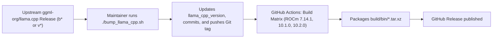

# llama.cpp for AMD Strix Halo

Prebuilt Linux `x86_64` binaries and build configurations for running upstream [`llama.cpp`](https://github.com/ggml-org/llama.cpp) on **AMD Strix Halo (`gfx1151`)** APUs with **ROCm HIP**, **Zen 5 CPU targeting**, and **unified-memory-aware (`GGML_HIP_UMA`)** flags.

[](https://github.com/Lychee-Technology/llama-cpp-for-strix-halo/releases)
[](https://github.com/Lychee-Technology/llama-cpp-for-strix-halo/actions/workflows/build-and-release.yml)
[](LICENSE)

-ED1C24)


[Download](https://github.com/Lychee-Technology/llama-cpp-for-strix-halo/releases) · [Compatibility](#compatibility-and-system-requirements) · [Quick Start](#quick-start) · [Unified Memory](#unified-memory-configuration) · [Build Optimizations](#build-optimizations) · [Troubleshooting](#troubleshooting) · [Build from Source](#build-from-source)

---

## Overview

AMD Strix Halo APUs combine Zen 5 CPU cores, an RDNA 3.5 integrated GPU (`gfx1151`), and high-capacity unified LPDDR5X system memory. While upstream `llama.cpp` now publishes generic Ubuntu ROCm binaries, compiling and tuning specifically for Strix Halo still requires non-default build choices:

- Targeting `gfx1151` and Zen 5 (`-march=znver5`, AVX-512) instead of broad generic targets.
- Enabling HIP unified memory allocation (`GGML_HIP_UMA=ON`) and quantized KV-cache FlashAttention kernels (`GGML_CUDA_FA_ALL_QUANTS=ON`).
- Applying ROCm/LLVM workarounds relevant to `gfx1151`, including disabling rocWMMA FlashAttention (`GGML_HIP_ROCWMMA_FATTN=OFF`) and raising the AMDGPU local loop-unroll threshold.

This repository tracks upstream `ggml-org/llama.cpp` releases and builds ready-to-extract Linux `x86_64` archives across multiple ROCm versions via GitHub Actions.

### Scope and Boundaries

| Layer | Responsibility |
|---|---|
| **Upstream [`llama.cpp`](https://github.com/ggml-org/llama.cpp)** | Inference engine, GGUF format, quantization, `llama-cli`, `llama-server`, `llama-bench`, and backend kernels. |
| **This repository** | Pinned upstream tracking ([`llama_cpp_version`](llama_cpp_version)), Strix Halo CMake/compiler flags, multi-ROCm CI builds, and Linux host documentation. |
| **Linux / AMDGPU / ROCm** | Kernel driver (`amdgpu`, `amdkfd`), TTM/GTT memory management, and host ROCm runtime libraries. |

> [!NOTE]
> **What this project is not:** This repository is not a separate inference engine, not a fork of `llama.cpp` source code, not an official AMD or `llama.cpp` distribution, and does not target the Ryzen AI NPU or other AMD GPU architectures.

<details>
<summary>Historical context (January 2026)</summary>

When this repository was created in January 2026, `llama.cpp` was one of the few runtimes that could practically utilize large unified memory pools (>80 GiB) on Strix Halo under Linux, upstream releases did not target Strix Halo's specific build flags, and older Linux kernels plus default TTM settings severely restricted GPU-addressable allocations. Upstream `llama.cpp` and Linux kernel support have since evolved, while this project continues to provide `gfx1151` + Zen 5 builds and unified-memory guidance.

</details>

---

## Key Features

- **Hardware-targeted Linux `x86_64` binaries:** Built specifically for AMD Strix Halo (`gfx1151`) and Zen 5 (`-march=znver5 -mtune=znver5`, AVX-512).
- **Unified-memory-aware HIP configuration:** Compiles with `GGML_HIP=ON` and `GGML_HIP_UMA=ON` so HIP can allocate unified memory on Strix Halo APUs.
- **Workarounds for known `gfx1151` regressions:** Sets `GGML_HIP_ROCWMMA_FATTN=OFF` and `-mllvm --amdgpu-unroll-threshold-local=600` in CI builds (see [Build Optimizations](#build-optimizations)).
- **Multiple ROCm build variants:** Publishes separate archives for ROCm `7.14.1`, `10.1.0`, and `10.2.0` from each release tag.
- **Upstream release tracking:** Mirrors upstream `b*` rolling tags and `v*` semantic releases via [`bump_llama_cpp.sh`](bump_llama_cpp.sh) and [`llama_cpp_version`](llama_cpp_version).

---

## Compatibility and System Requirements

### Hardware Requirements

- **CPU:** AMD Zen 5 `x86_64` processor (binaries are compiled with `-march=znver5` and AVX-512 flags and will not run on CPUs lacking Zen 5 / AVX-512 instructions).
- **GPU:** AMD Strix Halo integrated GPU (`gfx1151` ISA target only). Other RDNA 3 / 3.5 iGPUs or discrete GPUs (e.g., `gfx1100`–`gfx1103`, `gfx1150`) are not targeted.
- **System Memory:** Determines the maximum model size and context length you can load. Running 70B–120B+ parameter models depends on having sufficient physical RAM (such as 128 GiB SKUs), appropriate quantization, and adequate GPU-mappable memory; 32 GiB and 64 GiB systems are bounded accordingly.

### Software Requirements

- **OS:** Linux `x86_64` (built on Ubuntu 24.04 runners; distributions with older `glibc` than Ubuntu 24.04 are not verified).
- **Linux Kernel:** Kernel with `amdgpu` and `amdkfd` support for Strix Halo. **Linux `6.16.9+` or `6.18+`** is recommended because earlier kernels exhibited KFD/ROCm allocation caps near 15.5 GiB even when GTT was enlarged.
- **ROCm Runtime:** User-space ROCm runtime libraries matching the ROCm version of the archive you download (plus `amdgpu` kernel support and `render`/`video` group membership).

### Compatibility Matrix

The CI workflow runs **compile-only builds** on cloud runners without Strix Halo hardware; runtime execution depends on your host kernel and ROCm installation.

| Component | Target / Build Configuration | Verification Status | Notes |
|---|---|---|---|
| **GPU ISA** | `gfx1151` (AMD Strix Halo) | Build target (CI-verified) | Compiled with `GPU_TARGETS=gfx1151` and `AMDGPU_TARGETS=gfx1151` |
| **CPU ISA** | Zen 5 (`-march=znver5`, AVX-512) | Build target (CI-verified) | Portable across Zen 5 hosts (`GGML_NATIVE=OFF`) |
| **ROCm `7.14.1`** | Built via AMD runfile (`core,core-dev,dev-tools`) | Build-verified in CI | Not hardware-tested in CI; requires compatible host ROCm 7.x runtime |
| **ROCm `10.1.0`** | Built via AMD runfile (`core,core-dev,dev-tools`) | Build-verified in CI | Not hardware-tested in CI; requires compatible host ROCm 10.1 runtime |
| **ROCm `10.2.0`** | Built via AMD runfile (`core,core-dev,dev-tools`) | Build-verified in CI | Not hardware-tested in CI; requires compatible host ROCm 10.2 runtime |
| **Linux Distros** | Ubuntu 24.04 (`glibc` baseline) | Build environment | Other modern distros (Fedora, Arch/CachyOS) may work if `glibc` and ROCm runtime are compatible |

---

## Download and Installation

### 1. Choose a Release and ROCm Variant

Browse available builds on the [Releases page](https://github.com/Lychee-Technology/llama-cpp-for-strix-halo/releases).

- **Release tags:** `b<N>` tracks upstream rolling `llama.cpp` builds (e.g., `b12669`); `v<X.Y.Z>` tracks upstream semantic releases. The currently pinned tag is recorded in [`llama_cpp_version`](llama_cpp_version).
- **Asset naming:** `llama-cpp-<LLAMA_CPP_VER>-rocm-<ROCM_VER>-gfx1151.tar.xz`
- **Active ROCm matrix:** `7.14.1`, `10.1.0`, `10.2.0` (choose the version matching the ROCm runtime installed on your Linux host).

### 2. Install Prerequisites

Before running the binaries, ensure your Linux host has:

1. **AMDGPU kernel support & device permissions:** Your user must belong to the `render` and `video` groups to access `/dev/kfd` and `/dev/dri/*`:

   ```bash
   sudo usermod -aG render,video "$USER"
   ```

   Log out and back in (or reboot) for group changes to take effect. Verify with `groups`.

2. **ROCm user-space runtime:** Install the ROCm runtime matching your selected tarball (`7.14.1`, `10.1.0`, or `10.2.0`). You do **not** need the full ROCm compiler SDK just to run prebuilt binaries, only the runtime libraries and driver support. Follow AMD's official [ROCm Linux installation guide](https://rocm.docs.amd.com/projects/install-on-linux/en/latest/install/install-methods/package-manager-index.html) for your distribution, or AMD's ROCm runfile/tarball installers if using ROCm 10.x.

3. **Extraction tools:** Ensure `tar` and `xz` (`xz-utils` on Debian/Ubuntu, `xz` on Fedora/Arch) and `curl` are installed.

### 3. Download and Extract

The release `.tar.xz` archives package the contents of `llama.cpp/build/bin` directly at the archive root, so extract into a dedicated directory. Check the [Releases page](https://github.com/Lychee-Technology/llama-cpp-for-strix-halo/releases) and set `LLAMA_CPP_VER` and `ROCM_VER` to match the release you want:

```bash
# Example values — replace with the release tag and ROCm version you want to install
LLAMA_CPP_VER="b12669"
ROCM_VER="10.2.0"

ARCHIVE="llama-cpp-${LLAMA_CPP_VER}-rocm-${ROCM_VER}-gfx1151.tar.xz"
URL="https://github.com/Lychee-Technology/llama-cpp-for-strix-halo/releases/download/${LLAMA_CPP_VER}/${ARCHIVE}"

curl -fsSLO "${URL}"
mkdir -p llama-cpp-strix-halo
tar -xJf "${ARCHIVE}" -C llama-cpp-strix-halo
```

> [!NOTE]
> Release assets do not currently include `.sha256` checksum files. You can inspect downloaded archives locally with `tar -tf "${ARCHIVE}"` before extracting.

### 4. Verify Installation

Move into the extracted directory and add both the extracted directory (for bundled `libllama.so` / `libggml*.so`) and your ROCm library directory to `LD_LIBRARY_PATH`:

```bash
cd llama-cpp-strix-halo
export LD_LIBRARY_PATH="$PWD:/opt/rocm/lib:${LD_LIBRARY_PATH:-}"

# 1. Confirm all shared libraries resolve (should print no "not found" lines)
ldd ./llama-cli | grep "not found" || echo "All shared libraries resolved"

# 2. Check binary version and build info
./llama-cli --version

# 3. Check detected compute devices (look for HIP / Radeon 8060S / gfx1151)
./llama-cli --list-devices
```

If `/opt/rocm` is installed at a versioned path (e.g., `/opt/rocm-10.2.0/lib` or a custom runfile prefix), replace `/opt/rocm/lib` with your actual ROCm `lib` directory.

---

## Quick Start

Start with a small GGUF model to confirm end-to-end GPU inference before downloading large models. Model weights are provided by their respective authors under their own licenses.

### Example 1: Local CLI Inference (`llama-cli`)

Using `-hf` downloads a small model directly from Hugging Face (these builds link against `libcurl4-openssl-dev`). Alternatively, pass `-m /path/to/model.gguf` for an already downloaded local GGUF file:

```bash
# Single-turn prompt against a small Qwen3 GGUF model with full GPU layer offload
./llama-cli \
  -hf ggml-org/Qwen3-0.6B-GGUF \
  -ngl 99 \
  -st \
  -p "Explain unified memory in two sentences."
```

- `-ngl 99`: Offloads model layers to the HIP GPU backend (adjust or use `auto` depending on model size and available memory).
- `-st`: Runs a single turn and exits cleanly instead of entering interactive chat mode.

### Example 2: Local OpenAI-Compatible API Server (`llama-server`)

Bind to `127.0.0.1` so the server is only reachable from your local machine:

```bash
./llama-server \
  -m /path/to/your-model.gguf \
  -ngl 99 \
  --host 127.0.0.1 \
  --port 8080
```

> [!WARNING]
> Do not bind `--host 0.0.0.0` on untrusted networks without authentication and firewall rules. `llama-server` does not enforce user authentication by default.

In another terminal, test the local endpoint:

```bash
curl -s http://127.0.0.1:8080/v1/chat/completions \
  -H "Content-Type: application/json" \
  -d '{
    "model": "local",
    "messages": [{"role": "user", "content": "Say hello in one sentence."}],
    "max_tokens": 64
  }'
```

### Example 3: Throughput Benchmark (`llama-bench`)

Measure prompt processing (`pp`) and token generation (`tg`) throughput on a local model:

```bash
./llama-bench -m /path/to/your-model.gguf -ngl 99 -p 512 -n 128
```

### Verifying GPU Acceleration

A command starting without errors does not guarantee GPU execution—`llama.cpp` can silently fall back to CPU if HIP initialization fails or `-ngl` is omitted. Confirm GPU offload using these checks:

1. **Device discovery:** `./llama-cli --list-devices` lists a HIP/ROCm device (rather than only CPU).
2. **Startup logs:** Look for HIP device initialization and layer offload lines such as `offloaded X/Y layers to GPU` in stderr output.
3. **Live GPU monitoring:** Run `rocm-smi` or `amdgpu_top` in a second terminal while generating tokens to observe GPU compute/memory activity.

For additional CLI flags and server options, refer to the [upstream `llama.cpp` documentation](https://github.com/ggml-org/llama.cpp).

---

## Unified Memory Configuration

Strix Halo uses unified system memory instead of separate VRAM. On Linux, the `amdgpu` driver exposes system memory to the GPU through two mechanisms:

1. **BIOS UMA carve-out:** Static memory reserved at boot. Keeping this small (e.g., **512 MB–2 GB**) avoids locking RAM away from Linux.
2. **GTT via TTM (Translation Table Maps):** Dynamic GPU-mappable system RAM. By default, Linux TTM caps GPU-mappable memory at roughly **50% of physical RAM** (~64 GiB on a 128 GiB system).

### Check Before Changing Anything

If your model weights, KV cache, and runtime buffers fit inside ~50% of your RAM—and you are running a modern kernel (`6.16.9+` / `6.18+`)—**no kernel tuning is required**. Check your active limits first with read-only commands:

```bash
uname -r
cat /sys/module/ttm/parameters/pages_limit
cat /sys/module/ttm/parameters/page_pool_size
sudo dmesg | grep -i "amdgpu.*memory"
```

### Raising TTM Limits for Larger Models

When you need more than ~50% of system RAM mapped for GPU inference (for example, 70B–120B+ models on a 128 GiB system), adjust `ttm.pages_limit` and `ttm.page_pool_size` (measured in **4 KiB pages**, where `1 GiB = 262,144 pages`):

- **Leave headroom for the OS:** Assigning nearly all 128 GiB to TTM can trigger Linux OOM kills or freezes under memory pressure. A balanced target on a 128 GiB system is **108 GiB** (`28311552` pages, leaving ~20 GiB for Linux), or **97.7 GiB** (`25600000` pages) for a conservative setup.
- **`amdgpu.gttsize` is deprecated:** Modern kernels log a deprecation warning for `amdgpu.gttsize` and rely on `ttm.pages_limit`.
- **Distribution tooling differs:** Kernel command-line arguments (`grubby` on Fedora, `GRUB_CMDLINE_LINUX_DEFAULT` + `update-grub` on Ubuntu/Debian, `grub-mkconfig` or `systemd-boot` on Arch/CachyOS) work across both built-in and modular `ttm` kernels, whereas `update-initramfs` is Debian/Ubuntu-specific.

See **[docs/memory-configuration.md](docs/memory-configuration.md)** for the full step-by-step guide, page calculation table, distribution-specific commands, and rollback instructions.

---

## Build Optimizations

The table below summarizes every non-default target and optimization flag enabled in [`.github/workflows/build-and-release.yml`](.github/workflows/build-and-release.yml).

| Area | CI Setting | Rationale | Evidence / Caveat |
|---|---|---|---|
| **GPU target** | `-DGPU_TARGETS="gfx1151"` `-DAMDGPU_TARGETS="gfx1151"` | Compiles HIP kernels specifically for Strix Halo (`gfx1151`). | Verified in workflow; restricts binaries to `gfx1151` GPUs. |
| **CPU target** | `-DGGML_NATIVE=OFF` `-march=znver5 -mtune=znver5` + AVX/AVX2/AVX-512/VBMI/VNNI/BMI2/FMA/F16C | Targets Zen 5 hosts instead of the CI runner CPU while enabling Zen 5 SIMD extensions. | Verified in workflow; binaries will fail with `SIGILL` on non-Zen-5 / non-AVX-512 CPUs. |
| **Unified memory** | `-DGGML_HIP_UMA=ON` | Enables `hipMallocManaged` unified-memory support in the GGML HIP backend for APUs. | Verified in workflow; runtime effectiveness depends on kernel `amdgpu`/`amdkfd` and TTM configuration. |
| **KV-cache FlashAttention** | `-DGGML_CUDA_FA_ALL_QUANTS=ON` | Builds FlashAttention kernels for quantized KV caches instead of `f16`/`bf16` only. | Verified in workflow; avoids fallback to non-FA paths when quantized KV caches are requested. |
| **rocWMMA FlashAttention** | `-DGGML_HIP_ROCWMMA_FATTN=OFF` | Explicitly disabled due to severe `gfx115x` prefill regressions tracked in upstream [`llama.cpp#19984`](https://github.com/ggml-org/llama.cpp/issues/19984). | Verified in workflow; workaround intended to prevent regression rather than add a new feature. |
| **AMDGPU loop unroll** | `-mllvm --amdgpu-unroll-threshold-local=600` | Workaround for LLVM/ROCm loop-unrolling threshold regressions affecting `gfx1151` kernels (see [`llama.cpp#19984`](https://github.com/ggml-org/llama.cpp/issues/19984)). | Verified in workflow; compiler workaround rather than a general-purpose guarantee across future ROCm releases. |

<details>
<summary>Exact CMake configuration used in CI</summary>

```bash
export ROCM_PATH=/opt/rocm
export LLVM_BIN="$(hipconfig -l)"
export CFLAGS="-O3 -march=znver5 -mtune=znver5"
export HIP_FLAGS="--rocm-path=${ROCM_PATH} -mllvm --amdgpu-unroll-threshold-local=600"

cmake -B build \
  -DCMAKE_BUILD_TYPE=Release \
  -DCMAKE_C_COMPILER="${LLVM_BIN}/clang" \
  -DCMAKE_CXX_COMPILER="${LLVM_BIN}/clang++" \
  -DCMAKE_HIP_COMPILER="${LLVM_BIN}/clang" \
  -DCMAKE_HIP_FLAGS="${HIP_FLAGS}" \
  -DCMAKE_C_FLAGS="$CFLAGS" \
  -DCMAKE_CXX_FLAGS="$CFLAGS" \
  -DGGML_HIP=ON \
  -DGGML_NATIVE=OFF \
  -DGGML_AVX=ON \
  -DGGML_AVX2=ON \
  -DGGML_AVX512=ON \
  -DGGML_AVX512_VBMI=ON \
  -DGGML_AVX512_VNNI=ON \
  -DGGML_BMI2=ON \
  -DGGML_FMA=ON \
  -DGGML_F16C=ON \
  -DGGML_CUDA_FA_ALL_QUANTS=ON \
  -DLLAMA_BUILD_TESTS=OFF \
  -DLLAMA_BUILD_EXAMPLES=OFF \
  -DGPU_TARGETS="gfx1151" \
  -DAMDGPU_TARGETS="gfx1151" \
  -DGGML_HIP_UMA=ON \
  -DGGML_HIP_ROCWMMA_FATTN=OFF
```

</details>

---

## Performance and Benchmarks

This repository does not currently run automated GPU benchmarks in CI or publish controlled benchmark baselines. Because Strix Halo throughput varies significantly with model architecture, quantization, context length, Linux kernel version, ROCm version, and platform TDP/power profile, we avoid publishing unverified or uncontrolled token-per-second claims here.

### Reproducible Benchmark Method

To measure your own setup with `llama-bench`:

```bash
./llama-bench -m /path/to/model.gguf -ngl 99 -p 512,2048 -n 128 -fa on -r 3 -o md
```

If you submit benchmark results via an issue or pull request, please include:

- Hardware model, total RAM capacity, and power profile / TDP setting
- Linux distribution, kernel version (`uname -r`), and ROCm version
- Release archive filename (or upstream `llama.cpp` tag + build flags)
- Exact model artifact and quantization, context/prompt/generation lengths, `-ngl`, `-fa`, and full `llama-bench` command with raw output

---

## Runtime Selection

`llama.cpp` is a general-purpose GGUF inference runtime covering a wide range of dense and MoE models. However, specialized model architectures may benefit from dedicated engines with custom kernels:

| Runtime | Intended Workloads | Model Format | Strengths | Limitations |
|---|---|---|---|---|
| **`llama.cpp` (this distribution)** | General-purpose local LLMs, OpenAI-compatible serving, broad quantization support | GGUF | Mature tooling (`llama-cli`, `llama-server`, `llama-bench`), broad model coverage, Strix Halo `gfx1151` HIP + UMA build | Generic kernels may underperform specialized engines on niche architectures |
| **[Loom (`ROCm/hrx-system`)](https://github.com/ROCm/hrx-system)** | Heterogeneous AMD execution and specialized architectures such as looped/recurrent transformers (e.g., Inkling 2 Mini) | Loom model packages / GGUF checkpoints | JIT/kernel stack (`hrx-loom`) tuned for architectures like looped transformers on Strix Halo | Narrower model/ecosystem scope compared to `llama.cpp`; separate runtime install |
| **[Strata (`Niko1221/Strata`)](https://github.com/Niko1221/Strata)** | Large MoE and specialized architectures such as Inkling 2 Mini | Strata engine packages | Native `gfx1151` support and model-specific optimizations for supported architectures | Separate engine ecosystem and package format; verify current model support upstream |

Refer directly to the [Loom](https://github.com/ROCm/hrx-system) and [Strata](https://github.com/Niko1221/Strata) repositories for up-to-date model compatibility, installation commands, and developer benchmarks. Regardless of which GPU runtime you choose, Linux TTM memory limits still govern large allocations on Strix Halo.

---

## Troubleshooting

Follow **Observe → Diagnose → Resolve → Verify** before modifying system files.

| Symptom | Possible Cause | Diagnostic Action | Resolution |
|---|---|---|---|
| `error while loading shared libraries: libllama.so` or `libhip*.so` | Dynamic linker cannot find bundled `llama.cpp` libs or ROCm `lib/` | `ldd ./llama-cli \| grep "not found"` | Set `export LD_LIBRARY_PATH="$PWD:/opt/rocm/lib:${LD_LIBRARY_PATH:-}"` (or your ROCm lib path) and re-run `ldd`. |
| `--list-devices` shows no HIP/GPU device | Missing `render`/`video` group, `amdgpu` driver issue, or ROCm mismatch | `groups`; `ls -l /dev/kfd /dev/dri`; `rocminfo` | Add user to `render,video`, re-login, and confirm `rocminfo` lists `gfx1151`. |
| Inference runs slowly on CPU | `-ngl` omitted/zero, or HIP backend failed to initialize | Check stderr startup logs for `offloaded` layers and HIP errors | Pass `-ngl 99` (or `auto`) and resolve any HIP/library errors shown in startup logs. |
| Large model fails to allocate GPU memory | Default TTM (~50% RAM) reached, or Linux kernel `<= 6.15` KFD limit | `uname -r`; `cat /sys/module/ttm/parameters/pages_limit`; `sudo dmesg \| grep -i "amdgpu.*memory"` | Upgrade to kernel `6.16.9+`/`6.18+` if older; configure TTM limits via [docs/memory-configuration.md](docs/memory-configuration.md). |
| `Illegal instruction (core dumped)` | Host CPU is not Zen 5 / lacks AVX-512 instructions | `lscpu \| grep -i avx512` | These builds require Zen 5 / AVX-512; rebuild from source for your CPU target if needed. |
| System freezes or OOM kills during inference | TTM limit set too close to physical RAM without OS headroom | `dmesg -T \| grep -iE "oom\|killed process"` | Lower `ttm.pages_limit` (leave ~16–20 GiB for OS on 128 GiB systems) or use smaller quant/context. |

---

## Build from Source

The instructions below reproduce the CI build configuration from [`.github/workflows/build-and-release.yml`](.github/workflows/build-and-release.yml) for a pinned upstream tag. Note that these are **version-pinned, repeatable build instructions**, not bit-for-bit deterministic builds.

### Prerequisites

- Ubuntu 24.04 `x86_64` (or equivalent Linux environment)
- Build tools (`cmake`, `build-essential`, `libcurl4-openssl-dev`, `git`)
- ROCm toolchain (`core`, `core-dev`, `dev-tools`) installed at `/opt/rocm` (for example via AMD's runfile installer with `gfx=gfx1151`)

### Build Steps

```bash
# 1. Install build dependencies (Ubuntu / Debian example)
sudo apt-get update
sudo apt-get install -y cmake build-essential libcurl4-openssl-dev git

# 2. Read the pinned upstream llama.cpp tag from this repository
source ./llama_cpp_version

# 3. Clone upstream llama.cpp at the pinned tag
git clone --depth 1 --branch "${LLAMA_CPP_VER}" https://github.com/ggml-org/llama.cpp.git
cd llama.cpp

# 4. Configure using the ROCm LLVM toolchain and Strix Halo flags
export ROCM_PATH=/opt/rocm
export LLVM_BIN="$("${ROCM_PATH}/bin/hipconfig" -l)"
export CFLAGS="-O3 -march=znver5 -mtune=znver5"
export HIP_FLAGS="--rocm-path=${ROCM_PATH} -mllvm --amdgpu-unroll-threshold-local=600"

cmake -B build \
  -DCMAKE_BUILD_TYPE=Release \
  -DCMAKE_C_COMPILER="${LLVM_BIN}/clang" \
  -DCMAKE_CXX_COMPILER="${LLVM_BIN}/clang++" \
  -DCMAKE_HIP_COMPILER="${LLVM_BIN}/clang" \
  -DCMAKE_HIP_FLAGS="${HIP_FLAGS}" \
  -DCMAKE_C_FLAGS="$CFLAGS" \
  -DCMAKE_CXX_FLAGS="$CFLAGS" \
  -DGGML_HIP=ON \
  -DGGML_NATIVE=OFF \
  -DGGML_AVX=ON \
  -DGGML_AVX2=ON \
  -DGGML_AVX512=ON \
  -DGGML_AVX512_VBMI=ON \
  -DGGML_AVX512_VNNI=ON \
  -DGGML_BMI2=ON \
  -DGGML_FMA=ON \
  -DGGML_F16C=ON \
  -DGGML_CUDA_FA_ALL_QUANTS=ON \
  -DLLAMA_BUILD_TESTS=OFF \
  -DLLAMA_BUILD_EXAMPLES=OFF \
  -DGPU_TARGETS="gfx1151" \
  -DAMDGPU_TARGETS="gfx1151" \
  -DGGML_HIP_UMA=ON \
  -DGGML_HIP_ROCWMMA_FATTN=OFF

# 5. Compile
cmake --build build -- -j"$(nproc)"

# 6. Verify built binaries
LD_LIBRARY_PATH="$PWD/build/bin:${ROCM_PATH}/lib" ./build/bin/llama-cli --version
LD_LIBRARY_PATH="$PWD/build/bin:${ROCM_PATH}/lib" ./build/bin/llama-cli --list-devices
```

For the full, authoritative CI environment setup (including runfile installer options), see [`.github/workflows/build-and-release.yml`](.github/workflows/build-and-release.yml).

---

## Release Pipeline and Versioning

Upstream tracking is maintainer-triggered (there is no scheduled cron job in GitHub Actions), while compilation and GitHub Release publishing are automated on tag pushes:



- **Maintainer step:** [`bump_llama_cpp.sh`](bump_llama_cpp.sh) queries `ggml-org/llama.cpp` releases, tracks the newest `b*` rolling tag and `v*` semantic tag independently, updates [`llama_cpp_version`](llama_cpp_version), and pushes a matching commit and Git tag.
- **Automated CI step:** Pushing a `b*` or `v*` tag triggers [`.github/workflows/build-and-release.yml`](.github/workflows/build-and-release.yml), which builds all three ROCm variants on `blacksmith-2vcpu-ubuntu-2404` and publishes the `.tar.xz` archives via `softprops/action-gh-release`.
- **Verification boundary:** CI validates compilation and packaging only; no Strix Halo GPU execution tests run in GitHub Actions.

---

## Repository Structure

| File | Responsibility |
|---|---|
| [`.github/workflows/build-and-release.yml`](.github/workflows/build-and-release.yml) | ROCm build matrix, CMake configuration, `.tar.xz` packaging, and GitHub Release publishing |
| [`llama_cpp_version`](llama_cpp_version) | Pinned upstream `llama.cpp` release tag built by CI |
| [`bump_llama_cpp.sh`](bump_llama_cpp.sh) | Maintainer script to track upstream `b*` and `v*` releases and push mirror tags |
| [`docs/memory-configuration.md`](docs/memory-configuration.md) | Strix Halo Linux unified memory, TTM calculation, distro setup, and rollback guide |
| [`README.md`](README.md) | Primary project overview, installation, quick start, and build documentation |
| [`LICENSE`](LICENSE) | MIT license for this repository |

---

## Contributing

Contributions focused on Strix Halo build engineering and documentation are welcome:

- ROCm toolchain or CMake compatibility updates
- Strix Halo hardware verification reports and reproducible `llama-bench` measurements
- Documentation clarity and troubleshooting improvements
- Release automation enhancements

### Reporting Issues

Before opening an issue, check which layer owns the problem:

- **Packaging, CI builds, missing release variants, or these docs:** Open an issue in this repository.
- **Core model support, GGUF parsing, CLI flags, or HIP kernel bugs:** Report upstream at [`ggml-org/llama.cpp`](https://github.com/ggml-org/llama.cpp/issues).
- **Kernel panics, `amdgpu`/`amdkfd` driver bugs, or ROCm installer issues:** Check your Linux distribution or AMD ROCm issue trackers.

When reporting a bug here, please include:

- Strix Halo device model and physical RAM capacity
- Linux distribution, kernel version (`uname -r`), and ROCm version
- Exact downloaded archive filename and `llama.cpp` tag
- Model name, quantization, exact command run, and relevant stderr logs (including `--list-devices` output)

### Pull Request Workflow

1. Check existing issues and pull requests to avoid duplicate work.
2. Fork the repository and create a focused branch.
3. Keep changes scoped and consistent with [`.github/workflows/build-and-release.yml`](.github/workflows/build-and-release.yml).
4. Validate your changes locally (for example, shell/YAML syntax or markdown links) and open a pull request describing what was tested and on what hardware.

---

## License

This repository's scripts, workflow definitions, and documentation are licensed under the **[MIT License](LICENSE)** (Copyright © 2026 Lychee Technology Inc.).

- **Upstream `llama.cpp`:** Distributed under the [upstream `llama.cpp` MIT License](https://github.com/ggml-org/llama.cpp/blob/master/LICENSE).
- **ROCm & third-party runtime libraries:** Governed by their respective AMD ROCm and system library licenses.
- **Model weights:** Governed by the license terms specified by each model's publisher.

---

## Acknowledgments and Disclaimer

- **Community memory-tuning foundation:** Thanks to **Jeff Geerling** for documenting Linux AMD AI APU memory configuration in [*Increasing VRAM allocation on AMD AI APUs under Linux*](https://www.jeffgeerling.com/blog/2025/increasing-vram-allocation-on-amd-ai-apus-under-linux/) and the [Beowulf AI Cluster discussion](https://github.com/geerlingguy/beowulf-ai-cluster/issues/5).
- **Upstream ecosystems:** Thanks to the [`ggml-org/llama.cpp`](https://github.com/ggml-org/llama.cpp), GGML, AMD ROCm, and Strix Halo Linux communities.

**Disclaimer:** This project is **not affiliated with, endorsed by, or maintained by AMD or the `llama.cpp` maintainers**. Binaries are provided as-is without warranty, and kernel boot or module parameter changes carry system-stability risks—always back up existing configurations before modifying boot settings.
