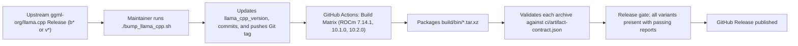

# Release Pipeline and Versioning

Upstream tracking is maintainer-triggered (there is no scheduled cron job in GitHub Actions), while compilation and GitHub Release publishing are automated on tag pushes:

- **Maintainer step:** [`bump_llama_cpp.sh`](../bump_llama_cpp.sh) queries `ggml-org/llama.cpp` releases, tracks the newest `b*` rolling tag and `v*` semantic tag independently, updates [`llama_cpp_version`](../llama_cpp_version), and pushes a matching commit and Git tag.
- **Automated CI step:** Pushing a `b*` or `v*` tag triggers [`.github/workflows/build-and-release.yml`](../.github/workflows/build-and-release.yml), which builds all three ROCm variants on `blacksmith-2vcpu-ubuntu-2404`, validates each archive, and publishes the `.tar.xz` archives via `softprops/action-gh-release` only after the release gate passes.
- **Artifact validation:** Each matrix job checks its archive against the [distribution contract](release-validation.md): naming, archive integrity, safe extraction, required executables and libraries, permissions, ELF architecture, dependency closure, and loader resolution with the matching ROCm installed. It also runs bounded `--version`/`--help` startup commands when the runner CPU supports the Zen 5 instruction set. The JSON reports are kept as workflow artifacts for 90 days.
- **Verification boundary:** CI validates compilation, packaging, and dependency resolution on a GPU-less runner. No Strix Halo GPU execution tests run in GitHub Actions.
